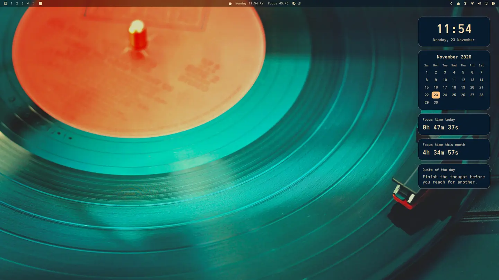
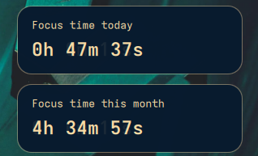
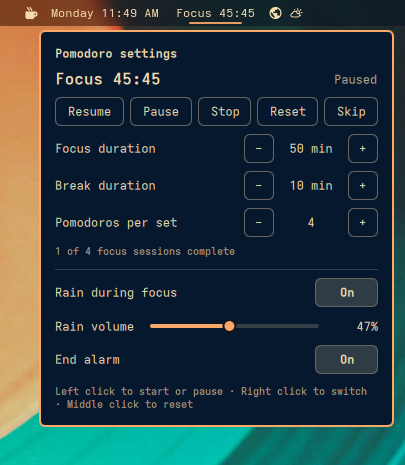
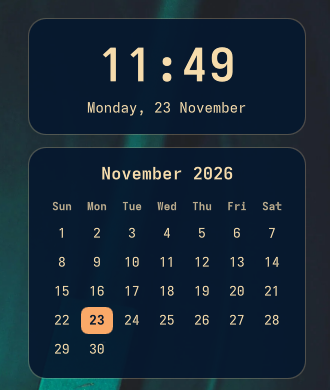

# Focus Widgets for Omarchy

Focus Widgets adds a timer to the top of your screen and puts a few helpful cards on your desktop. It works with Omarchy Linux.

## What you get

- **Focus timer.** Pick how long you want to work and how long you want to rest. One work timer is called a Pomodoro.
- **Timer buttons.** Hover over the timer to find **Start**, **Pause**, **Stop**, **Reset**, and **Skip**. If you're on a break and ready to work again, click **Skip**.
- **Rain sound and a chime.** Play gentle rain while you work, adjust its volume, or turn it off. An optional chime tells you when time is up.
- **Desktop cards.** See the time, calendar, quote of the day, how long you’ve focused today and this month, and a slideshow for your own pictures.

## What it looks like

**The whole desktop** · The timer sits beside the clock in the top bar. The desktop cards sit along the right edge.



[See the whole desktop with the timer panel open](screenshots/overview-panel.webp).

**Focus totals** · See how much time you've focused today and this month. These pictures use example totals.



**Pomodoro timer** · Hover over the timer beside the clock to open these controls.



**Desktop widgets** · The clock and calendar sit on the desktop, above the focus totals and daily quote.



**Photo slideshow** · Two frames from the same slideshow. The screenshot uses sample pictures.


## How to install

1. On this GitHub page, click **Code**, then **Download ZIP**.
2. Open the ZIP and extract the folder inside.
3. Open a terminal in that folder. Copy this line into the terminal and press Enter.

   ```bash
   bash install.sh
   ```

4. Look near the clock at the top of your screen for the timer. Look at your desktop to see the cards.

Use a running Omarchy desktop with Quickshell plugins. The bundle was prepared for Omarchy 4.5.0-3. You can use it without an administrator password. Rain playback uses `mpv`. The chime uses `paplay`.

## Show your own pictures

1. Open **Downloads**, then open the **Slideshow** folder.
2. Drop a few JPG, PNG, or WebP pictures into it.
3. Go to an empty workspace. The rounded frame below **Quote of the Day** shows one picture at a time and changes every **8 seconds**.

The timer for the next picture pauses while an app window is open on your current workspace. Your pictures stay on your computer.

## Try your first session

1. Hover over the timer near the clock.
2. Set **Focus duration** to 10 minutes and **Break duration** to 2 minutes.
3. Click **Start** and work on one task.
4. When the timer ends, click **Start** for your break. Click **Skip** if you'd rather go straight to the next focus session.

The timer saves your settings on your computer. The installer downloads the full rain track from the [original study video](https://youtu.be/Qo7N-HbEMxE) (223 MiB). Once downloaded, it plays offline. If the download fails, the timer uses the smaller rain sound included in the ZIP.

To skip the large download, run `bash install.sh --no-audio-download`.

### Use your own rain sound

If you have a local copy of the audio you want to use, save it as
`~/.config/omarchy/pomodoro-rain.m4a`. The timer will try that file first and
use the included rain sound if the file is missing or cannot play. If you set
`XDG_CONFIG_HOME`, use its `omarchy` folder instead.

You can also [download the original track directly](https://github.com/OfficiallyCarbine/omarchy-focus-widgets/releases/download/v1.0.0/pomodoro-rain.m4a).

## Want the shared top-bar layout too?

Open a terminal in the same folder and run:

```bash
bash install.sh --bar-layout
```

This puts a see-through bar at the top and arranges the clock, timer, and system icons. It may turn on Omarchy's weather widget, which gets forecasts online. The installer saves a copy of your old shell settings before it makes changes.

## How to turn it off

```bash
omarchy plugin disable local.pomodoro
omarchy plugin disable local.desktop-widgets
```

If you tried the shared bar layout, your old layout is in a backup named `shell.json.focus-widgets.*` in `~/.config/omarchy/`.
